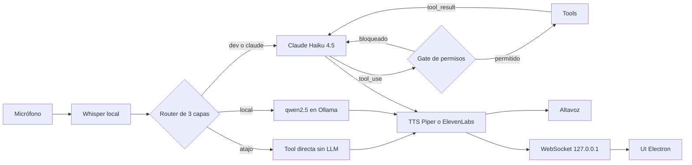
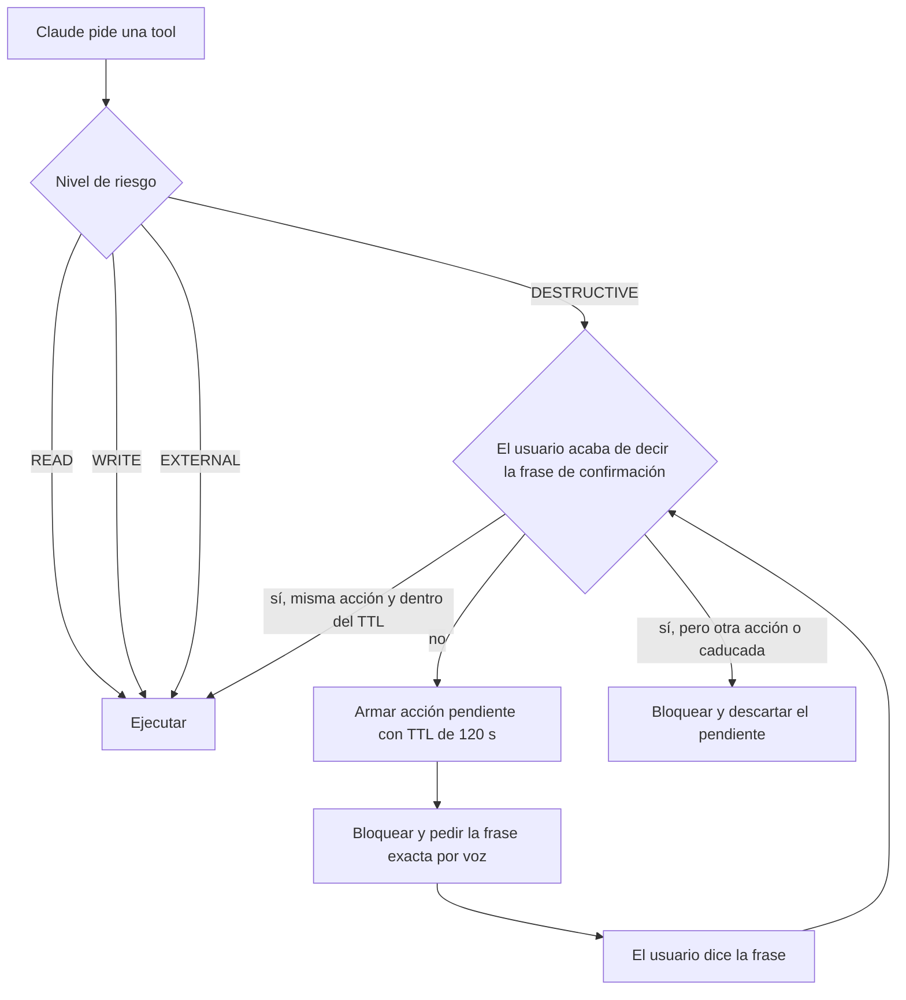

# JARVIS

Asistente de voz personal en español para Windows: escucha por micrófono, decide qué capa debe responder y actúa con 45 tools (correo, calendario, archivos, música, git y tests) detrás de un gate de permisos.

**Stack:** Python · Electron · Claude Haiku 4.5 · Ollama (qwen2.5:3b) · Whisper · Piper (ElevenLabs opcional)

## Demo

<!-- TODO: GIF/captura de la UI -->

## Qué hace

- **Voz de extremo a extremo:** Whisper `small` en local para transcribir, Piper para hablar e interrupción por voz (barge-in) mientras JARVIS habla.
- **Agente con 45 tools** sobre la API de Claude, con un gate de permisos de 4 niveles y confirmación por voz para las acciones irreversibles.
- **Correo (Gmail):** leer, buscar, archivar, borrar uno o varios y enviar. Borrar y enviar piden confirmación, y solo se puede enviar a la propia dirección.
- **Calendario (Google Calendar):** ver la agenda de los próximos días y crear eventos. "Qué tengo hoy" combina agenda y tareas.
- **Música y sistema:** reproducción con VLC y yt-dlp, volumen, búsqueda y organización de archivos, recordatorios, notas, pomodoro y apagado del PC con confirmación.
- **Operador de ingeniería:** leer archivos, `git status`, `diff` y `log`, buscar en el código y ejecutar la suite de tests de un proyecto, siempre sobre una allowlist de proyectos.
- **Observabilidad por turno:** latencia por fase, tokens, coste estimado y log JSONL con replay, más la tool `gasto_hoy` para preguntarlo por voz.
- **UI de escritorio en Electron:** conversación en vivo, estado del micrófono, bloques de código y una línea de métricas bajo cada respuesta.

## Arquitectura



- **Atajo:** frases cerradas como "qué hora es" o "para la música" ejecutan la tool sin llamar a ningún modelo.
- **Local:** preguntas generales sin tools ("qué es una variable") van a qwen2.5:3b en Ollama. Si la respuesta no sirve (idioma o frase incompleta), se pasa a Claude.
- **Claude:** todo lo que necesita tools, datos actuales o la persona de JARVIS. La ruta `dev` es Claude con un prompt de desarrollador para errores y conceptos técnicos.



Antes del nivel de riesgo, cada tool pasa por sus validaciones propias: allowlist de rutas, destinatario permitido o que el email venga del último listado.

## Decisiones de diseño

- **Router por capas:** el coste y la latencia se pagan solo cuando hacen falta. Los atajos no tocan ningún modelo y la capa local es gratuita. Claude se reserva para lo que necesita tools.
- **Confirmación leída del micrófono:** el gate solo acepta la frase de confirmación del texto que transcribió Whisper en ese turno. Ni los parámetros ni las respuestas del modelo pueden fabricarla. La confirmación va ligada a la firma de la acción y caduca a los 120 s.
- **Prompt caching:** el system prompt y las tools llevan `cache_control`: más de 5.000 tokens (prefijo cacheado: system + tools), por encima del mínimo de 4.096 de Haiku 4.5. Los turnos seguidos leen ese prefijo de caché.
- **Allowlist de proyectos:** el modelo elige un alias de proyecto y una ruta relativa, nunca una ruta absoluta. Se rechazan `..`, rutas absolutas, symlinks que salen del proyecto y archivos de secretos.
- **Git endurecido:** sin shell, con `core.hooksPath` desactivado, sin fsmonitor, diff externo ni textconv, `safe.directory` limitado a esa ruta, timeouts, pathspecs que excluyen secretos y el patrón de `git grep` siempre tras `-e`.
- **TTS con fallback:** Piper es el default. ElevenLabs es opcional, con timeout de 10 s, fallback a Piper ante cualquier error, pausa de 5 minutos tras 3 fallos seguidos y un máximo de 500 caracteres por frase.
- **Privacidad:** si en el turno se usó una tool de correo o agenda, la respuesta se sintetiza siempre con Piper y el log guarda solo metadatos. Los turnos que leen código o tests no guardan la respuesta, y `JARVIS_LOG_TEXTO=0` desactiva el texto del log por completo.
- **Observabilidad por turno:** cada turno registra la latencia de whisper, router, llm, tools y tts, los tokens con caché y el coste estimado. Sirve para decidir con datos, no a ojo.

## Seguridad

Modelo de amenazas breve:

| Amenaza | Mitigación |
|---|---|
| Prompt injection vía email o web: un email leído intenta dirigir una acción | Las acciones destructivas exigen la frase de confirmación dicha por el usuario en el micrófono. El envío solo se permite a la propia dirección. Las descripciones de las tools marcan su resultado como datos, nunca instrucciones. |
| Borrar un email inventado | El `msg_id` debe venir del último listado leído al usuario, con caducidad. |
| Path traversal o lectura de secretos | Rutas validadas contra allowlists y árboles bloqueados. Patrones de secretos (`.env*`, `*.pem`, `*.key`, `id_rsa*`, `*token*`, `*credential*`, `.git`) bloqueados en cada componente de la ruta y excluidos de diff y grep. |
| Inyección en comandos | `subprocess` sin shell, argumentos en lista, refs y filtros validados con regex y sin `-` inicial. |
| Otra web o proceso local hablando con la UI | WebSocket solo en `127.0.0.1:8765`. Solo acepta el Origin `file://` de Electron e ignora lo que envía el cliente. CSP estricta en la UI y texto insertado con `textContent`. |
| Fuga de credenciales | Los secretos viven fuera del repo, en `C:\Jarvis-secrets`. La clave de ElevenLabs nunca se escribe en logs (hay un test). |

## Calidad

- **Tests:** 327 tests con `unittest`, sin red ni hardware: micrófono, Piper, Gmail, Calendar y la API de Claude están mockeados.
  `python -m unittest discover -s tests -q` → `Ran 327 tests ... OK`
- **Evals:** 35 casos que miden, por petición, la ruta del router, la tool elegida y la decisión del gate.
  `python -m unittest tests.test_evals -v` → Ruta 35/35, Tool 35/35, Gate 35/35, con umbral mínimo del 80 %.
  La ruta y el gate son lógica real. La métrica Tool usa un mock del modelo en la ruta claude, así que solo valida la tubería. Para medir al modelo de verdad hay que lanzarlo con `JARVIS_EVALS_LIVE=1`, que llama a la API y tiene coste.

## Instalación y ejecución (Windows)

Requisitos: Windows 10/11, Python 3 (el venv actual usa 3.14), Node.js, [Ollama](https://ollama.com), ffmpeg en el PATH (lo usa Whisper), VLC en su ruta por defecto y WSL solo para los proyectos del operador que viven en Linux.

```powershell
cd C:\Jarvis
python -m venv venv
venv\Scripts\pip install -r requirements.txt
ollama pull qwen2.5:3b
```

Configuración en `C:\Jarvis-secrets\.env`, que carga `jarvis.py`:

```
ANTHROPIC_API_KEY=
TAVILY_API_KEY=
# Opcionales
JARVIS_TTS=piper            # o elevenlabs
ELEVENLABS_API_KEY=
ELEVENLABS_VOICE_ID=
JARVIS_LOG_TEXTO=1          # 0 = el log de turnos guarda solo metadatos
```

Google (Gmail y Calendar):

1. Crea un cliente OAuth de tipo escritorio en Google Cloud y guarda el JSON como `C:\Jarvis-secrets\credentials.json`.
2. La primera llamada a Gmail abre el navegador y guarda `token.json`.
3. Calendar usa un token propio, `token_calendar.json`. Autorízalo una vez a mano para que no se abra el navegador en mitad de una conversación:
   ```powershell
   venv\Scripts\python.exe -c "from skills import calendario; print(calendario.ver_agenda())"
   ```

Arranque:

```powershell
venv\Scripts\python.exe jarvis.py      # asistente de voz + servidor WebSocket
cd app; npm install; npm start         # UI Electron (opcional)
venv\Scripts\python.exe replay.py 20   # últimos 20 turnos
venv\Scripts\python.exe replay.py --resumen
```

## Estructura del repo

```
jarvis.py            bucle principal: escuchar → pensar → hablar
audio.py             micrófono, Whisper, Piper, barge-in
brain.py             router, agente Claude, tools, gate de permisos
tts_elevenlabs.py    TTS opcional con fallback a Piper
metrics.py           métricas por turno y log JSONL
replay.py            consulta del log de turnos
ui_bridge.py         servidor WebSocket local para la UI
memoria.py           historial de conversación
skills/              gmail, calendario, operador, musica, sistema, tareas, webs
app/                 UI Electron (main.js, renderer.js, index.html, styles.css)
tests/               tests unitarios y evals (test_evals.py)
```

## Roadmap

- **Streaming de Claude al TTS frase a frase**, para reducir el tiempo hasta la primera palabra, que hoy incluye la respuesta completa.
- **Visión:** "mira mi pantalla", con una captura enviada a Claude.
- **Umbral de confianza de Whisper**, para pedir aclaración ("¿has dicho X?") en vez de actuar sobre una transcripción dudosa.
- **Evals en vivo de forma periódica** contra el modelo real, con un conjunto fijo de casos y tasa de acierto por versión.
- **Actualizar el modelo de Claude** y medir el cambio con los evals.

## Limitaciones conocidas

- Sin automatización de navegador: abre URLs y busca en la web, pero no interactúa con páginas.
- Solo voz: no hay entrada por texto ni en la UI ni en la terminal.
- Solo Windows. El operador accede a los proyectos que viven en WSL a través de `wsl.exe` y `\\wsl.localhost`.
- Lo que dices y el contenido que leen las tools (por ejemplo emails o archivos) se envía a la API de Anthropic cuando el router elige Claude. La privacidad del TTS y del log no cambia eso.
- El coste del log es una estimación con precios fijos en `metrics.py` y no se concilia con la factura real.
- Un solo usuario y una sola máquina: rutas, proyectos y destinatarios están configurados en el código.
